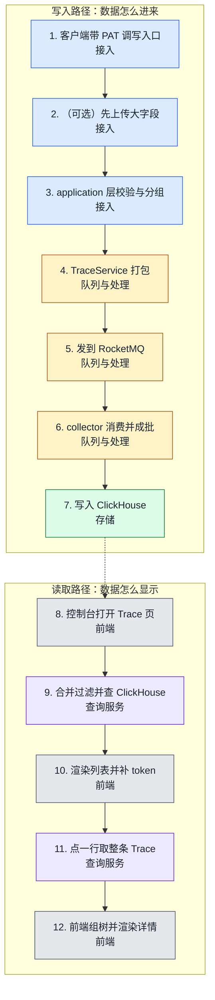

# coze-loop · 用户路径

本页给出 coze-loop 的逐步数据路径。先看图，再看每步的证据。回到 [coze-loop 总览](index.md)。

## 路径图

图例：接入、队列与处理、存储、查询服务、前端、评估。虚线表示写入和读取之间靠存储相连。

## 逐步证据

1. 客户端用 PAT 调 `POST /v1/loop/traces/ingest` 或 OTLP 入口。
   - 经过：Hertz 路由、`PatTokenVerifyMW`。
   - 证据：[backend/api/router/coze/loop/apis/coze.loop.apis.go L490](https://github.com/wzqwtt/coze-loop/blob/3a6a2bf07b057fec0c702e514e8345fb5684e83a/backend/api/router/coze/loop/apis/coze.loop.apis.go#L490)、[backend/api/router/coze/loop/apis/middleware.go L32-L34](https://github.com/wzqwtt/coze-loop/blob/3a6a2bf07b057fec0c702e514e8345fb5684e83a/backend/api/router/coze/loop/apis/middleware.go#L32-L34)、[backend/api/router/coze/loop/apis/middleware/pat_verify.go L20-L69](https://github.com/wzqwtt/coze-loop/blob/3a6a2bf07b057fec0c702e514e8345fb5684e83a/backend/api/router/coze/loop/apis/middleware/pat_verify.go#L20-L69)。
2. 若有大字段，客户端先 `POST /v1/loop/files/upload`，再在 span 的 `object_storage` 里引用 key。
   - 经过：foundation 的文件服务。
   - 证据：[idl/thrift/coze/loop/foundation/coze.loop.foundation.openapi.thrift L29](https://github.com/wzqwtt/coze-loop/blob/3a6a2bf07b057fec0c702e514e8345fb5684e83a/idl/thrift/coze/loop/foundation/coze.loop.foundation.openapi.thrift#L29)、[backend/api/router/coze/loop/apis/coze.loop.apis.go L622-L623](https://github.com/wzqwtt/coze-loop/blob/3a6a2bf07b057fec0c702e514e8345fb5684e83a/backend/api/router/coze/loop/apis/coze.loop.apis.go#L622-L623)。
3. `OpenAPIApplication.IngestTraces` 校验 workspace 一致、检查写入权限、设 `call_type`、查权益、按租户分组、检查批量上限。
   - 经过：application 层、`AuthProvider`、`SpanContextExtractor`、`BenefitService`。
   - 证据：[backend/modules/observability/application/openapi.go L108-L176](https://github.com/wzqwtt/coze-loop/blob/3a6a2bf07b057fec0c702e514e8345fb5684e83a/backend/modules/observability/application/openapi.go#L108-L176)、[backend/modules/observability/application/openapi.go L244-L261](https://github.com/wzqwtt/coze-loop/blob/3a6a2bf07b057fec0c702e514e8345fb5684e83a/backend/modules/observability/application/openapi.go#L244-L261)。
4. `TraceService.IngestTraces` 跑 ingest processor，打成 `TraceData`，交给 producer。
   - 经过：domain 层 service、`trace_producer`。
   - 证据：[backend/modules/observability/domain/trace/service/trace_service.go L1627-L1655](https://github.com/wzqwtt/coze-loop/blob/3a6a2bf07b057fec0c702e514e8345fb5684e83a/backend/modules/observability/domain/trace/service/trace_service.go#L1627-L1655)。
5. producer 把消息压缩后发到 RocketMQ topic `trace_ingestion_event`。
   - 经过：RocketMQ。
   - 证据：[backend/modules/observability/infra/mq/producer/trace_producer.go L42-L74](https://github.com/wzqwtt/coze-loop/blob/3a6a2bf07b057fec0c702e514e8345fb5684e83a/backend/modules/observability/infra/mq/producer/trace_producer.go#L42-L74)、[release/deployment/docker-compose/conf/observability.yaml L1-L10](https://github.com/wzqwtt/coze-loop/blob/3a6a2bf07b057fec0c702e514e8345fb5684e83a/release/deployment/docker-compose/conf/observability.yaml#L1-L10)。
6. collector 的 RMQ receiver 消费、校验并丢弃非法 span，queue processor 按 1000 条或 1 秒成批。
   - 经过：collector 的 receiver 与 processor。
   - 证据：[backend/modules/observability/domain/trace/service/collector/receiver/rmqreceiver/rmq_receiver.go L60-L86](https://github.com/wzqwtt/coze-loop/blob/3a6a2bf07b057fec0c702e514e8345fb5684e83a/backend/modules/observability/domain/trace/service/collector/receiver/rmqreceiver/rmq_receiver.go#L60-L86)、[release/deployment/docker-compose/conf/observability.yaml L330-L355](https://github.com/wzqwtt/coze-loop/blob/3a6a2bf07b057fec0c702e514e8345fb5684e83a/release/deployment/docker-compose/conf/observability.yaml#L330-L355)。
7. ClickHouse exporter 按 TTL 与 workspace 分组，写入 `observability_spans`。
   - 经过：exporter、`TraceRepo`、ck DAO。
   - 证据：[backend/modules/observability/domain/trace/service/collector/exporter/clickhouseexporter/clickhouse_exporter.go L30-L54](https://github.com/wzqwtt/coze-loop/blob/3a6a2bf07b057fec0c702e514e8345fb5684e83a/backend/modules/observability/domain/trace/service/collector/exporter/clickhouseexporter/clickhouse_exporter.go#L30-L54)、[backend/modules/observability/infra/repo/trace.go L184-L201](https://github.com/wzqwtt/coze-loop/blob/3a6a2bf07b057fec0c702e514e8345fb5684e83a/backend/modules/observability/infra/repo/trace.go#L184-L201)。
8. 用户在控制台打开 Trace 页，前端调 `POST /api/observability/v1/spans/list`。
   - 经过：`SessionMW`、`TraceApplication.ListSpans`（校验、`readLoopTrace` 权限、时间窗校正）。
   - 证据：[backend/api/router/coze/loop/apis/coze.loop.apis.go L22](https://github.com/wzqwtt/coze-loop/blob/3a6a2bf07b057fec0c702e514e8345fb5684e83a/backend/api/router/coze/loop/apis/coze.loop.apis.go#L22)、[backend/modules/observability/application/trace.go L163-L173](https://github.com/wzqwtt/coze-loop/blob/3a6a2bf07b057fec0c702e514e8345fb5684e83a/backend/modules/observability/application/trace.go#L163-L173)、[frontend/packages/loop-pages/observation-pages/src/pages/trace/trace-render.tsx L69-L77](https://github.com/wzqwtt/coze-loop/blob/3a6a2bf07b057fec0c702e514e8345fb5684e83a/frontend/packages/loop-pages/observation-pages/src/pages/trace/trace-render.tsx#L69-L77)。
9. `TraceService.ListSpans` 合并平台内置过滤（`call_type = Custom`、root span、workspace）和用户过滤，查 ClickHouse，挂标注，跑平台与过期处理器，返回游标。
   - 经过：domain service、`span_filter`、`TraceRepo`、`SpansCkDao`、`span_processor`。
   - 证据：[backend/modules/observability/domain/trace/service/trace_service.go L1392-L1459](https://github.com/wzqwtt/coze-loop/blob/3a6a2bf07b057fec0c702e514e8345fb5684e83a/backend/modules/observability/domain/trace/service/trace_service.go#L1392-L1459)、[backend/modules/observability/domain/trace/service/trace/span_filter/cozeloop_filter.go L16-L41](https://github.com/wzqwtt/coze-loop/blob/3a6a2bf07b057fec0c702e514e8345fb5684e83a/backend/modules/observability/domain/trace/service/trace/span_filter/cozeloop_filter.go#L16-L41)、[backend/modules/observability/infra/repo/trace.go L215-L277](https://github.com/wzqwtt/coze-loop/blob/3a6a2bf07b057fec0c702e514e8345fb5684e83a/backend/modules/observability/infra/repo/trace.go#L215-L277)。
10. 前端渲染列表；对 root span 再批量请求 token 汇总。
    - 经过：`observation-components` 的 `trace-list`。
    - 证据：[frontend/packages/loop-components/observation-components/src/features/trace-list/components/queries/table/hooks/use-fetch-traces.tsx L59-L88](https://github.com/wzqwtt/coze-loop/blob/3a6a2bf07b057fec0c702e514e8345fb5684e83a/frontend/packages/loop-components/observation-components/src/features/trace-list/components/queries/table/hooks/use-fetch-traces.tsx#L59-L88)、[backend/modules/observability/domain/trace/service/trace_service.go L1657-L1740](https://github.com/wzqwtt/coze-loop/blob/3a6a2bf07b057fec0c702e514e8345fb5684e83a/backend/modules/observability/domain/trace/service/trace_service.go#L1657-L1740)。
11. 用户点一行，前端调 `GET /api/observability/v1/traces/:trace_id`，后端取该 trace 的全部 span，`AttrTosProcessor` 把大字段 key 换成签名 URL。
    - 经过：`TraceApplication.GetTrace`、`TraceService.GetTrace`、`span_processor`、file RPC。
    - 证据：[backend/modules/observability/application/trace.go L254-L291](https://github.com/wzqwtt/coze-loop/blob/3a6a2bf07b057fec0c702e514e8345fb5684e83a/backend/modules/observability/application/trace.go#L254-L291)、[backend/modules/observability/domain/trace/service/trace_service.go L1255-L1344](https://github.com/wzqwtt/coze-loop/blob/3a6a2bf07b057fec0c702e514e8345fb5684e83a/backend/modules/observability/domain/trace/service/trace_service.go#L1255-L1344)、[backend/modules/observability/domain/trace/service/trace/span_processor/attr_tos_processor.go L23-L72](https://github.com/wzqwtt/coze-loop/blob/3a6a2bf07b057fec0c702e514e8345fb5684e83a/backend/modules/observability/domain/trace/service/trace/span_processor/attr_tos_processor.go#L23-L72)。
12. 前端用 `parent_id` 组成树，按 span 类型渲染 Run 和 Metadata 页签。
    - 经过：`trace-detail`、`trace-data`。
    - 证据：[frontend/packages/loop-components/observation-components/src/features/trace-detail/utils/span.tsx L18-L70](https://github.com/wzqwtt/coze-loop/blob/3a6a2bf07b057fec0c702e514e8345fb5684e83a/frontend/packages/loop-components/observation-components/src/features/trace-detail/utils/span.tsx#L18-L70)、[frontend/packages/loop-components/observation-components/src/features/trace-detail/components/span-detail/index.tsx L38-L41](https://github.com/wzqwtt/coze-loop/blob/3a6a2bf07b057fec0c702e514e8345fb5684e83a/frontend/packages/loop-components/observation-components/src/features/trace-detail/components/span-detail/index.tsx#L38-L41)。
