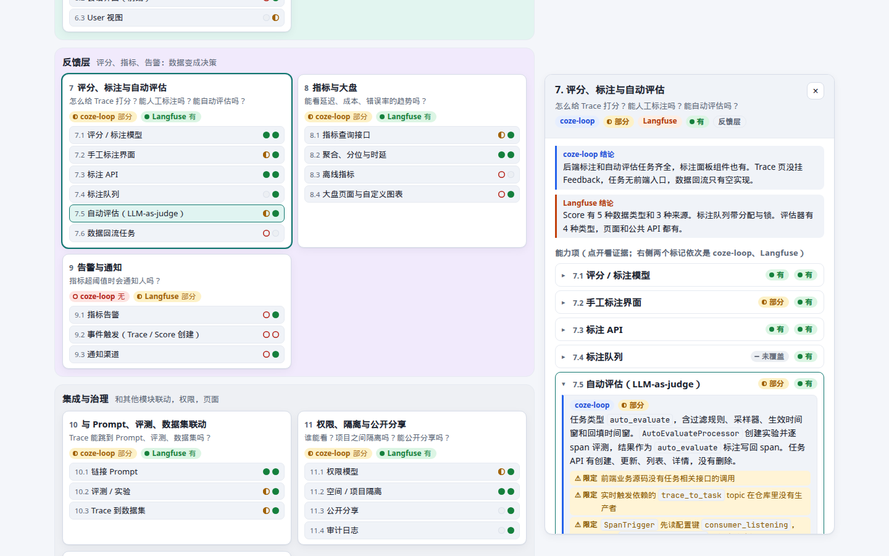
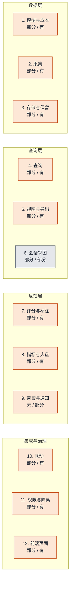

# 可观测功能设计：coze-loop vs Langfuse

本专题对照两个开源 LLM 平台的可观测功能。范围从「一次调用怎么入库」到「指标超阈值怎么告警」。
结论来自两个仓库在固定提交上的静态源码阅读。每条事实链到源码。推断单独标 **【推断】**。

- 想点着看：[交互页面](interactive.mdx)。也可以[单独打开](pathname:///html/observability-feature-design/)。
- 想逐项对比：[对照表](comparison.md)。
- 想看单个系统：[coze-loop](coze-loop/index.md)、[Langfuse](langfuse/index.md)。

## 源码版本

| 系统 | 仓库 | 提交 |
|---|---|---|
| coze-loop | [wzqwtt/coze-loop](https://github.com/wzqwtt/coze-loop) | [`3a6a2bf0`](https://github.com/wzqwtt/coze-loop/tree/3a6a2bf07b057fec0c702e514e8345fb5684e83a) |
| Langfuse | [wzqwtt/langfuse](https://github.com/wzqwtt/langfuse) | [`f75c661d`](https://github.com/wzqwtt/langfuse/tree/f75c661dbe8c6b85523c81486b39e8403ac2c141) |

下文链接都指向这两个提交的 blob。

## 能力地图

12 组能力分四层。每个方块第二行写出两边的组状态，顺序是 coze-loop / Langfuse。蓝色表示 coze-loop 领先，橙色表示 Langfuse 领先，灰色表示持平。

## 结论

- coze-loop 已调研 45 项：22 项有，12 项部分，11 项无。
- Langfuse 已调研 47 项：45 项有，1 项部分，1 项无。
- 数据层相似。两边都是「先落队列或对象存储，再批量写 ClickHouse」。Langfuse 多一份 S3 原始事件。
- 差距集中在反馈层和前端。coze-loop 的后端先行，开源前端只露出一个 Trace 页。
- Langfuse 的限定在读写入口。默认 `events_only` 下，旧写入口只收 score-create，公共 v1 读接口返回 404。
- 三类缺口最明显：金额成本、告警、大盘。coze-loop 都没有。

## 状态总览

| 层 | 能力组 | coze-loop | Langfuse | 要回答的问题 |
|---|---|---|---|---|
| 数据层 | 1. Trace / Span 模型与成本 | 部分 | 有 | 一次调用在库里长什么样？Token 和钱怎么算？ |
| 数据层 | 2. 采集 | 部分 | 有 | 数据怎么进来？有没有队列、鉴权、限流？ |
| 数据层 | 3. 存储、保留与大字段 | 部分 | 有 | 数据存在哪？保留多久？大字段放哪？ |
| 查询层 | 4. 查询：列表、详情、过滤与分页 | 部分 | 有 | 怎么找到一条 Trace？能怎么筛、怎么排、怎么翻页？ |
| 查询层 | 5. 视图预设、列配置与导出 | 部分 | 有 | 筛选条件能保存吗？列能自定义吗？数据能导出吗？ |
| 查询层 | 6. Session、thread 与 User 视图 | 部分 | 部分 | 多轮对话和终端用户能按会话看吗？ |
| 反馈层 | 7. 评分、标注与自动评估 | 部分 | 有 | 怎么给 Trace 打分？能人工标注吗？能自动评估吗？ |
| 反馈层 | 8. 指标与大盘 | 部分 | 有 | 能看延迟、成本、错误率的趋势吗？ |
| 反馈层 | 9. 告警与通知 | 无 | 部分 | 指标超阈值时会通知人吗？ |
| 集成与治理 | 10. 与 Prompt、评测、数据集联动 | 部分 | 有 | Trace 能跳到 Prompt、评测、数据集吗？ |
| 集成与治理 | 11. 权限、隔离与公开分享 | 部分 | 有 | 谁能看？项目之间隔离吗？能公开分享吗？ |
| 集成与治理 | 12. 前端页面与组件 | 部分 | 有 | 界面上到底能点出什么？ |

组状态由组内各项推出。全部「有」是「有」。全部「无」是「无」。其余是「部分」。未覆盖的项不参与。

## 关键发现

| 发现 | 详情 | 证据页 |
|---|---|---|
| **后端先行，开源前端只露出 Trace**（coze-loop） | 指标、任务、导出到数据集、thread 与 chat、trajectory 等后端能力，前端业务源码没有调用。 | 12.2 其他观测页面：[coze-loop](coze-loop/integration-governance.md) · [Langfuse](langfuse/integration-governance.md) |
| **只有 token，没有金额成本**（coze-loop） | coze-loop 没有单价和计价逻辑。Langfuse 在采集时按模型价格表计算成本。 | 1.4 金额成本与价格表：[coze-loop](coze-loop/model-ingest-storage.md) · [Langfuse](langfuse/model-ingest-storage.md) |
| **写入没有限流**（coze-loop） | coze-loop 的写入入口没有限流，限流只用于查询和标注。Langfuse 有限流，但自托管默认不生效。 | 2.6 写入限流：[coze-loop](coze-loop/model-ingest-storage.md) · [Langfuse](langfuse/model-ingest-storage.md) |
| **告警：coze-loop 无，Langfuse 部分**（两边） | Langfuse 有 Monitor、Webhook、Slack、GitHub dispatch。事件源里没有 Trace 或 Score 创建。 | 9.1 指标告警：[coze-loop](coze-loop/feedback-metrics.md) · [Langfuse](langfuse/feedback-metrics.md) |
| **自动评估只有后端**（coze-loop） | coze-loop 的任务没有前端入口，实时触发缺少生产者【推断】。Langfuse 有页面、公共 API 和队列。 | 7.5 自动评估（LLM-as-judge）：[coze-loop](coze-loop/feedback-metrics.md) · [Langfuse](langfuse/feedback-metrics.md) |
| **保留策略：一个只记录，一个要授权**（coze-loop） | coze-loop 建表语句没有 TTL，也没有清理任务。Langfuse 会物理清理，但需要企业权益。 | 3.2 保留与物理清理：[coze-loop](coze-loop/model-ingest-storage.md) · [Langfuse](langfuse/model-ingest-storage.md) |
| **Langfuse 默认 events_only**（Langfuse） | 旧的 JSON 写入口只收 score-create。旧 SDK 要改用 OTLP，或把模式切到 dual。 | 2.1 JSON 写入入口：[coze-loop](coze-loop/model-ingest-storage.md) · [Langfuse](langfuse/model-ingest-storage.md) |
| **events_only 下公共 v1 读接口返回 404**（Langfuse） | 只有 v2 observations、v3 scores、v2 metrics 可读。 | 4.1 列表与详情接口：[coze-loop](coze-loop/query-views.md) · [Langfuse](langfuse/query-views.md) |
| **Session：后端有，前端没接**（coze-loop） | coze-loop 有 thread 与 chat 接口。Langfuse 有页面和公共 API，但 events_only 下公共 sessions API 返回 404。 | 6.2 会话界面（前端）：[coze-loop](coze-loop/query-views.md) · [Langfuse](langfuse/query-views.md) |

## 怎么读状态

| 状态 | 含义 |
|---|---|
| 有 | 源码里有完整实现。 |
| 部分 | 有实现，但缺一环，或有限定条件。 |
| 无 | 已搜索，未找到。 |
| 未覆盖 | 调研没有覆盖这一项。不计入统计，也不代表「无」。 |

「限定」是补充说明，不改变状态。例如 Langfuse 的摄入端点在 `events_only` 下只收 score-create。

## 术语

两边都用「Trace」这个词，但存储对象不同。

| 概念 | coze-loop | Langfuse |
|---|---|---|
| Trace | 没有独立 Trace 表。它是同一 `trace_id` 下 span 的查询视图。 | v4 里是 `events_full` 按 `trace_id` 聚合出的视图。旧版另有 `traces` 表。 |
| 基本单元 | Span，16 个类型常量。 | Observation，10 种 `ObservationType`。 |
| 状态 | 只有成功和失败。 | 四级 level：ERROR、WARNING、DEFAULT、DEBUG。 |
| 会话 | `thread_id` 标签，没有独立会话表。 | `session_id` 列，没有独立会话实体。 |
| 成本 | 只有 token 数，没有金额。 | 采集时按模型价格表计算。 |

以上各行的证据见[对照表](comparison.md)的第 1 组和第 6 组。

## 文档索引

| 文档 | 内容 |
|---|---|
| [对照表](comparison.md) | 12 组、50 项的逐项对照：状态、事实、限定、源码、差异、修正、推断。 |
| [交互页面](interactive.mdx) | 能力地图、并排对照、证据抽屉、数据路径、筛选与搜索。 |
| [coze-loop 总览](coze-loop/index.md) | coze-loop 的能力清单、推断、修正、限制。 |
| [Langfuse 总览](langfuse/index.md) | Langfuse 的能力清单、推断、修正、限制。 |
| 模型、采集与存储（[coze-loop](coze-loop/model-ingest-storage.md) · [Langfuse](langfuse/model-ingest-storage.md)） | Trace 模型、采集入口、鉴权限流、存储与保留 |
| 查询、视图与会话（[coze-loop](coze-loop/query-views.md) · [Langfuse](langfuse/query-views.md)） | 列表与详情、过滤、聚合、视图预设、导出、会话视图 |
| 评分、指标与告警（[coze-loop](coze-loop/feedback-metrics.md) · [Langfuse](langfuse/feedback-metrics.md)） | 评分与标注、自动评估、指标与大盘、告警与通知 |
| 联动、治理与前端（[coze-loop](coze-loop/integration-governance.md) · [Langfuse](langfuse/integration-governance.md)） | 与 Prompt、评测、数据集联动，权限与隔离，前端页面 |
| 用户路径（[coze-loop](coze-loop/user-path.md) · [Langfuse](langfuse/user-path.md)） | 从一次 SDK 上报到列表与详情可见的逐步路径 |

## 推断与限制

- 推断不是源码直接写明的事实。每条推断都在对照表对应能力组下列出，并给出依据。
- 所有结论来自静态阅读，没有运行服务。
- 外部 SDK 源码不在两个仓库内。SDK 侧的批量、重试、限流行为未核实。
- 商业版（闭源）可能有开源仓库里看不到的能力。
