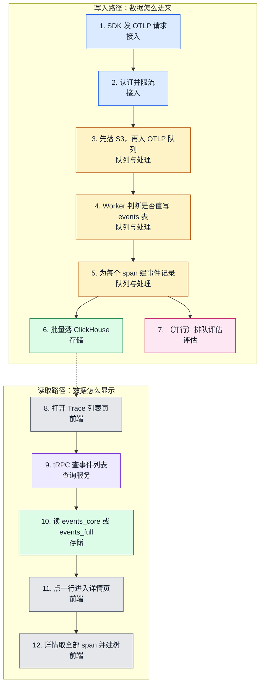
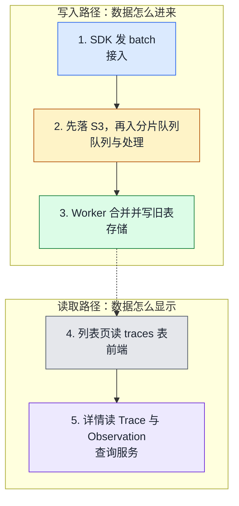

# Langfuse · 用户路径

本页给出 Langfuse 的逐步数据路径。先看图，再看每步的证据。回到 [Langfuse 总览](index.md)。

## 路径图

默认模式 `events_only` 走 OTLP 路径。旧 SDK 走 legacy 路径。

### OTLP 路径（默认）

### legacy 路径（旧 SDK）

图例：接入、队列与处理、存储、查询服务、前端、评估。虚线表示写入和读取之间靠存储相连。

## 逐步证据

下面分两条路径。默认的 `events_only` 走 OTLP 路径。旧 SDK 走 legacy 路径。

### 13.1 默认路径（OTLP，v4）

1. SDK 发 `POST /api/public/otel/v1/traces`，要求 `traces:create`（`web/src/pages/api/public/otel/v1/traces/index.ts` L26-L33，[permalink](https://github.com/wzqwtt/langfuse/blob/f75c661dbe8c6b85523c81486b39e8403ac2c141/web/src/pages/api/public/otel/v1/traces/index.ts#L26-L33)）。
2. 路由认证（Basic 或 Bearer）并限流（`web/src/features/public-api/server/apiAuth.ts` L92，[permalink](https://github.com/wzqwtt/langfuse/blob/f75c661dbe8c6b85523c81486b39e8403ac2c141/web/src/features/public-api/server/apiAuth.ts#L92)、`web/src/features/public-api/server/RateLimitService.ts` L47-L50，[permalink](https://github.com/wzqwtt/langfuse/blob/f75c661dbe8c6b85523c81486b39e8403ac2c141/web/src/features/public-api/server/RateLimitService.ts#L47-L50)）。
3. 请求体先上传到 S3，再进 `OtelIngestionQueue`（`packages/shared/src/server/otel/OtelIngestionProcessor.ts` L330-L342，[permalink](https://github.com/wzqwtt/langfuse/blob/f75c661dbe8c6b85523c81486b39e8403ac2c141/packages/shared/src/server/otel/OtelIngestionProcessor.ts#L330-L342)）。
4. Worker 判断是否直写 events 表（`worker/src/queues/otelIngestionQueue.ts` L310-L322，[permalink](https://github.com/wzqwtt/langfuse/blob/f75c661dbe8c6b85523c81486b39e8403ac2c141/worker/src/queues/otelIngestionQueue.ts#L310-L322)）。
5. `processOtelEvents` 为每个 span 建事件记录并写入 `events_full` 的写队列（`worker/src/features/otel-ingestion/processOtelEvents.ts` L154，[permalink](https://github.com/wzqwtt/langfuse/blob/f75c661dbe8c6b85523c81486b39e8403ac2c141/worker/src/features/otel-ingestion/processOtelEvents.ts#L154)）。
6. `ClickhouseWriter` 批量落库，`events_core` 由物化视图填充（`worker/src/services/ClickhouseWriter/index.ts` L61-L63，[permalink](https://github.com/wzqwtt/langfuse/blob/f75c661dbe8c6b85523c81486b39e8403ac2c141/worker/src/services/ClickhouseWriter/index.ts#L61-L63)、`packages/shared/clickhouse/migrations/canonical/0041_create_events_core_mv.up.sql` L39-L42，[permalink](https://github.com/wzqwtt/langfuse/blob/f75c661dbe8c6b85523c81486b39e8403ac2c141/packages/shared/clickhouse/migrations/canonical/0041_create_events_core_mv.up.sql#L39-L42)）。
7. 同时，若有匹配的评估规则，`scheduleObservationEvals` 排队评估（`worker/src/features/otel-ingestion/processOtelEvents.ts` L134，[permalink](https://github.com/wzqwtt/langfuse/blob/f75c661dbe8c6b85523c81486b39e8403ac2c141/worker/src/features/otel-ingestion/processOtelEvents.ts#L134)）。
8. 用户打开 Trace 列表页，页面根据 `isV4` 选择 `ObservationsEventsTable`（`web/src/features/traces/TracesPage.tsx` L97-L107，[permalink](https://github.com/wzqwtt/langfuse/blob/f75c661dbe8c6b85523c81486b39e8403ac2c141/web/src/features/traces/TracesPage.tsx#L97-L107)）。
9. 表调 `api.events.all`（`web/src/features/events/hooks/useEventsTableData.ts` L106，[permalink](https://github.com/wzqwtt/langfuse/blob/f75c661dbe8c6b85523c81486b39e8403ac2c141/web/src/features/events/hooks/useEventsTableData.ts#L106)），服务端是 `events.all` → `getEventList`（`web/src/features/events/server/eventsRouter.ts` L159-L168，[permalink](https://github.com/wzqwtt/langfuse/blob/f75c661dbe8c6b85523c81486b39e8403ac2c141/web/src/features/events/server/eventsRouter.ts#L159-L168)）。
10. 列表读 `events_core`（截断版）或 `events_full`（`packages/shared/src/server/queries/clickhouse-sql/query-fragments.ts` L97，[permalink](https://github.com/wzqwtt/langfuse/blob/f75c661dbe8c6b85523c81486b39e8403ac2c141/packages/shared/src/server/queries/clickhouse-sql/query-fragments.ts#L97)）。
11. 点击一行进入 `/project/[projectId]/traces/[traceId]`（`web/src/pages/project/[projectId]/traces/[traceId].tsx` L9，[permalink](https://github.com/wzqwtt/langfuse/blob/f75c661dbe8c6b85523c81486b39e8403ac2c141/web/src/pages/project/%5BprojectId%5D/traces/%5BtraceId%5D.tsx#L9)）。
12. 详情 hook 调 `events.byTraceId` 取全部 span，前端建树与时间线（`web/src/features/events/hooks/useEventsTraceData.ts` L62，[permalink](https://github.com/wzqwtt/langfuse/blob/f75c661dbe8c6b85523c81486b39e8403ac2c141/web/src/features/events/hooks/useEventsTraceData.ts#L62)、`web/src/features/traces/components/VirtualizedTree.tsx` L87，[permalink](https://github.com/wzqwtt/langfuse/blob/f75c661dbe8c6b85523c81486b39e8403ac2c141/web/src/features/traces/components/VirtualizedTree.tsx#L87)）。

### 13.2 legacy 路径（旧 SDK，需 `legacy` 或 `dual` 模式）

1. SDK 发 `POST /api/public/ingestion`（`web/src/pages/api/public/ingestion.ts` L56-L70，[permalink](https://github.com/wzqwtt/langfuse/blob/f75c661dbe8c6b85523c81486b39e8403ac2c141/web/src/pages/api/public/ingestion.ts#L56-L70)）。
2. 事件上传 S3 后进分片 `IngestionQueue`（`packages/shared/src/server/ingestion/processEventBatch.ts` L276-L332，[permalink](https://github.com/wzqwtt/langfuse/blob/f75c661dbe8c6b85523c81486b39e8403ac2c141/packages/shared/src/server/ingestion/processEventBatch.ts#L276-L332)、`packages/shared/src/server/ingestion/processEventBatch.ts` L328-L346，[permalink](https://github.com/wzqwtt/langfuse/blob/f75c661dbe8c6b85523c81486b39e8403ac2c141/packages/shared/src/server/ingestion/processEventBatch.ts#L328-L346)）。
3. Worker `mergeAndWrite` 合并事件，写 `traces` / `observations` / `scores`（`worker/src/services/IngestionService/index.ts` L238-L268，[permalink](https://github.com/wzqwtt/langfuse/blob/f75c661dbe8c6b85523c81486b39e8403ac2c141/worker/src/services/IngestionService/index.ts#L238-L268)）。
4. 列表页用 `TracesTable` 调 `api.traces.all`（`web/src/features/traces/TracesTable.tsx` L525，[permalink](https://github.com/wzqwtt/langfuse/blob/f75c661dbe8c6b85523c81486b39e8403ac2c141/web/src/features/traces/TracesTable.tsx#L525)）。
5. 详情用 `traces.byIdWithObservationsAndScores`（`web/src/server/api/routers/traces.ts` L384，[permalink](https://github.com/wzqwtt/langfuse/blob/f75c661dbe8c6b85523c81486b39e8403ac2c141/web/src/server/api/routers/traces.ts#L384)）。
